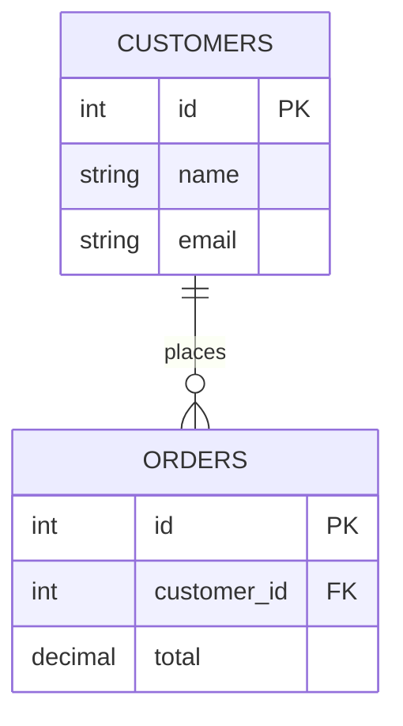
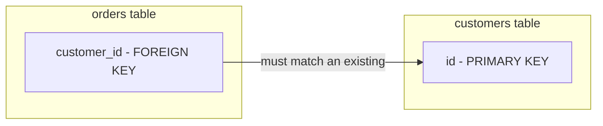

> [!important] TL;DR An **RDBMS (Relational Database Management System)** stores data in **tables** (relations) with strict schemas and enforced relationships between them, using **SQL** as the query interface. It's the industry's default choice for any workload where data correctness and relationships matter more than raw write-throughput — think bank balances, not tweet counters.

---

## 1. Overview

### What is RDBMS?

> [!note] Intuition First Picture a perfectly organized set of **spreadsheets** — one for customers, one for orders, one for products — where every spreadsheet has fixed column headers, and rows in one spreadsheet can _reference_ rows in another (an order references a customer by ID, not by copy-pasting their whole address). That's an RDBMS, formalized and made mathematically rigorous.

**Formal definition:** An RDBMS is a DBMS built on Edgar Codd's **relational model** (1970), which represents data as a collection of **relations** (tables), where each relation is a set of **tuples** (rows) sharing the same **attributes** (columns), with relationships enforced through **keys** rather than physical pointers.

This note assumes you've already read [[What is DBMS]] and [[Types of Databases]] — RDBMS is one specific, dominant _type_ of DBMS covered in that note.

### Why It Was Introduced

Before the relational model, databases used **hierarchical** and **network** models — data was linked via literal pointers between records. This worked, but:

- Querying required you to _know the physical navigation path_ to the data (no declarative "just tell me what you want").
- Changing the physical structure broke every application that navigated it.
- There was no mathematical foundation to reason about correctness.

Codd's relational model fixed this by proposing that data be represented **purely logically** — as tables related by shared key values — and queried **declaratively**. You say _what_ you want; the DBMS figures out _how_ to get it.

> [!tip] Interview Angle If asked "why do relational databases use tables instead of pointers," the answer they're looking for is **data independence**: tables decouple your queries from the physical storage layout, unlike navigational (pointer-based) models. This is the single most important "why" in this entire note.

### Why It Became the Industry Standard

- **Mathematical rigor** — grounded in set theory and predicate logic ([[Relational Algebra]] if that note exists in your vault), so query correctness can be formally reasoned about.
- **SQL** — a single, standardized, human-readable query language adopted across virtually every vendor.
- **ACID guarantees** — see [[ACID]] — critical for any system where losing or double-counting data is unacceptable (banking, inventory, billing).
- **Decades of optimization** — query planners, indexing (B+ Trees), and storage engines have been refined since the 1970s, making RDBMS extremely fast for the workloads it targets.

---

## 2. Characteristics

|Characteristic|What It Means|
|---|---|
|**Tables (Relations)**|Data is organized into 2D tables — rows and columns|
|**Rows (Tuples)**|Each row is a single record/instance of the entity the table represents|
|**Columns (Attributes)**|Each column represents one property, with a fixed data type|
|**Schema**|The predefined structure (table names, column names, types, constraints) — enforced _before_ data is written|
|**Keys**|Special columns (Primary Key, Foreign Key) that uniquely identify rows and link tables together|
|**Relationships**|Logical connections between tables, expressed via foreign keys, not physical pointers|
|**Constraints**|Rules (`NOT NULL`, `UNIQUE`, `CHECK`, foreign key constraints) enforced automatically by the database|

```sql
CREATE TABLE customers (
    id INT PRIMARY KEY AUTO_INCREMENT,
    name VARCHAR(100) NOT NULL,
    email VARCHAR(255) UNIQUE
);

CREATE TABLE orders (
    id INT PRIMARY KEY AUTO_INCREMENT,
    customer_id INT NOT NULL,
    total DECIMAL(10,2) CHECK (total >= 0),
    FOREIGN KEY (customer_id) REFERENCES customers(id)
);
```

> [!warning] Common Mistake Thinking "schema" just means "the tables." Schema specifically means the **structure and rules** — types, constraints, relationships — not the data itself. This distinction trips people up in interviews when discussing schema migrations.

---

## 3. Core Concepts

> [!note] Why this section matters These are the exact vocabulary words interviewers use when they say "walk me through the relational model." If you can't define each crisply in one sentence, you'll stumble on an easy question.

|Term|Definition|Analogy|
|---|---|---|
|**Relational Model**|The theoretical foundation representing data as mathematical relations (sets of tuples)|The "rulebook" the whole RDBMS is built on|
|**Entity**|A real-world object or concept being modeled (e.g., a Customer)|The "thing" a table represents|
|**Tuple**|A single row in a relation — one instance of the entity|One specific customer, e.g., "Alice"|
|**Attribute**|A column — a named property of the entity|"email," "name," "id"|
|**Domain**|The set of allowable values for an attribute|For `age`, the domain might be integers 0–150|
|**Degree**|The number of attributes (columns) in a relation|A table with 5 columns has degree 5|
|**Cardinality**|The number of tuples (rows) currently in a relation|A table with 10,000 customers has cardinality 10,000|

```sql
-- degree = 3 (id, name, email)
-- cardinality = number of rows currently in the table
SELECT * FROM customers;
```

> [!tip] 30-Second Interview Answer _"Degree is how many columns a table has — it's fixed by the schema. Cardinality is how many rows it has right now — it changes as data is inserted or deleted."_ This distinction is a classic quick-fire interview question — answer it fast and move on.

### Relations, Not Pointers



Notice: `orders.customer_id` doesn't physically point to a memory address — it holds a **value** that logically matches `customers.id`. The DBMS resolves this relationship at query time. This is the core insight that makes the relational model flexible and independent of physical storage.

---

## 4. Why RDBMS is Better Than "Traditional DBMS" (Navigational Models)

> [!note] "Traditional DBMS" here refers to pre-relational models: **hierarchical** (tree-structured, e.g., IBM IMS) and **network** (graph-structured, CODASYL). See [[Types of Databases]] for the full historical timeline.

|Aspect|Hierarchical/Network DBMS|RDBMS|
|---|---|---|
|Data access|Navigational (must know the path/pointer chain)|Declarative (SQL — say _what_, not _how_)|
|Relationships|Physical pointers|Logical keys (Primary Key ↔ Foreign Key)|
|Flexibility|Rigid — changing structure breaks navigation paths|Flexible — schema changes largely isolated via data independence|
|Many-to-many relationships|Awkward (hierarchical especially)|Natural, via junction tables|
|Query language|None standardized; custom per system|SQL — standardized across vendors|
|Mathematical foundation|Ad hoc|Set theory + predicate logic|

### Practical Example

**Hierarchical approach:** To find "all courses a student is enrolled in," you'd need to physically traverse from the student record down through pointers to enrollment records to course records — the _path itself_ is baked into how you write the program.

**RDBMS approach:**

```sql
SELECT c.name
FROM courses c
JOIN enrollments e ON c.id = e.course_id
WHERE e.student_id = 42;
```

You just describe _what_ you want. The query optimizer decides the most efficient path — you never write "traversal logic."

---

## 5. Advantages

- ✅ **Data integrity** — constraints (PK, FK, `CHECK`, `NOT NULL`) are enforced automatically, not left to application code
- ✅ **Reduced redundancy** — normalization (separate note, likely `Normalization.md` in your vault) minimizes duplicate data
- ✅ **Powerful querying** — SQL joins let you combine data across tables flexibly, without predefined access paths
- ✅ **ACID transactions** — see [[ACID]] — critical correctness guarantees for concurrent, multi-step operations
- ✅ **Mature tooling** — decades of query optimizers, ORMs, monitoring, and backup tooling
- ✅ **Strong consistency by default** — what you read reflects the true, committed state of the data

## 6. Disadvantages

- ❌ **Harder to scale horizontally** — traditionally designed for a single powerful server; sharding/distributing an RDBMS is non-trivial (though modern systems like CockroachDB/Spanner address this — see [[Types of Databases#NewSQL Databases]] if present)
- ❌ **Rigid schema** — adding/changing columns requires migrations; doesn't suit rapidly evolving or highly variable data shapes
- ❌ **Join overhead at massive scale** — deeply normalized schemas can require expensive multi-table joins under very high load
- ❌ **Not ideal for unstructured/semi-structured data** — a document database fits nested/variable JSON far more naturally

> [!warning] Common Mistake Saying "RDBMS can't scale." This is an oversimplification. RDBMS scales _vertically_ very well and can scale _horizontally_ with effort (read replicas, sharding, or NewSQL systems) — it's just not _automatic_ the way many NoSQL systems are designed to be from day one.

---

## 7. Real-World Applications

|Domain|Why RDBMS Fits|
|---|---|
|Banking & Payments|Strict consistency, ACID transactions, auditability|
|E-commerce order/inventory systems|Relationships between customers, orders, products must stay consistent|
|Healthcare records|Regulatory compliance, strong integrity requirements|
|ERP / HR systems|Complex, well-defined relationships between entities|
|Airline reservation systems|Must never double-book or lose a reservation|

---

## 8. Popular RDBMS

|Database|Known For|
|---|---|
|**MySQL**|Widely used in web apps; simple replication; huge community|
|**PostgreSQL**|Feature-rich, strong standards compliance, extensible (JSONB, custom types); favored at many modern startups and increasingly at large tech companies|
|**Oracle DB**|Enterprise-grade, extremely mature, heavy in banking/telecom, expensive licensing|
|**SQL Server**|Deep integration with the Microsoft ecosystem|
|**SQLite**|Embedded, serverless, single-file — used in mobile apps, browsers|

> [!tip] Interview Angle If asked "Postgres or MySQL, which would you pick?" — there's rarely a "wrong" answer; interviewers want to hear **trade-off reasoning**: Postgres tends to have richer data types (JSONB, arrays) and stricter standards compliance; MySQL has historically had simpler replication and a larger legacy web ecosystem. Naming _a_ reasonable trade-off beats confidently declaring one "better."

---

## 9. Interview Perspective

### Frequently Asked Interview Questions

<details> <summary>1. What's the difference between a Primary Key and a Foreign Key?</summary>

A **Primary Key** uniquely identifies each row in its own table (no duplicates, no NULLs). A **Foreign Key** is a column in one table that references a Primary Key in another table, enforcing that the referenced row actually exists.



</details> <details> <summary>2. Why use a relational database over a NoSQL database?</summary>

When your data has well-defined relationships, needs strong consistency, and benefits from complex querying/joins — think financial transactions, not a high-write chat message log. See [[OLTP vs OLAP]] and [[CAP Theorem]] for the deeper trade-off framing.

</details> <details> <summary>3. What is normalization, and why does it matter?</summary>

The process of structuring tables to minimize redundancy and avoid update anomalies, by ensuring each piece of data is stored once and referenced elsewhere via keys.

</details> <details> <summary>4. Can an RDBMS handle unstructured data?</summary>

To a degree — modern RDBMS (e.g., Postgres's `JSONB`) support semi-structured columns — but the RDBMS still isn't optimized as the _primary_ model for highly variable, deeply nested, schema-less data the way a document database is.

</details> <details> <summary>5. How does an RDBMS ensure data integrity during concurrent writes?</summary>

Through transactions and isolation levels — guaranteed by the **ACID** properties. See [[ACID]] for the full breakdown (Atomicity, Consistency, Isolation, Durability).

</details>

### Common Misconceptions

> [!warning] Misconception 1 "RDBMS = SQL." SQL is the _query language_; RDBMS is the _system_. NoSQL databases can also support SQL-like languages (e.g., Cassandra's CQL) — the label "NoSQL" refers to the data model, not literal absence of SQL syntax.

> [!warning] Misconception 2 "Normalized = always better." Over-normalization can hurt read performance in analytics-heavy workloads — see [[OLTP vs OLAP]] for when denormalization is the right call.

> [!warning] Misconception 3 "RDBMS can't scale, so modern systems always use NoSQL." Many of the largest systems in the world (banking cores, Stripe's payment ledger) run on heavily-optimized, sharded RDBMS — scale is achievable, just not automatic.

### What Interviewers Actually Expect

- Not rote definitions — **reasoning about trade-offs**.
- Connecting RDBMS concepts to **real system design decisions** (e.g., "I'd use Postgres here because I need transactional guarantees across these three writes").
- Recognizing **when NOT to use an RDBMS** (see FAANG Notes below) — this signals maturity beyond memorized facts.

---

## 10. FAANG Notes 🏢

### What Engineers Actually Care About

At companies like Stripe, MongoDB (ironically), Databricks, and Snowflake, engineers don't pick an RDBMS because "it's the default" — they pick it because:

- They need **multi-row, multi-table transactional consistency** (e.g., Stripe's core ledger _must_ be RDBMS-backed — money can't be "eventually consistent").
- They need **complex ad-hoc querying** across relationships without pre-computing every access pattern.
- They value **decades of battle-tested tooling** — backup, replication, monitoring, query optimization.

### Why Scalability Matters

At FAANG scale, a single RDBMS instance eventually can't handle the write volume or geographic distribution required. Engineers then reach for:

- **Read replicas** — scale reads horizontally, writes still go to one primary.
- **Sharding** — partition data across many RDBMS instances by key (e.g., `user_id % N`) — operationally complex, but keeps ACID guarantees _within_ a shard.
- **NewSQL systems** (Google Spanner, CockroachDB) — attempt globally distributed ACID guarantees, trading off latency and complexity.

> [!tip] Interview Angle If asked to design a system with both relational integrity _and_ massive scale, the strongest answers acknowledge this tension directly: _"I'd start with a single strongly-consistent RDBMS for the core transactional data, and introduce read replicas or sharding only once I have evidence the single instance is the bottleneck — premature sharding adds huge complexity."_

### When RDBMS Should NOT Be Used

|Scenario|Better Fit|Why|
|---|---|---|
|Simple key-based caching/sessions|Key-Value store (Redis)|RDBMS overhead (transactions, joins) is unnecessary for O(1) lookups|
|Deeply nested, schema-varying documents|Document DB (MongoDB)|Forcing variable JSON into rigid tables causes constant schema churn|
|Massive write throughput, simple access pattern|Column-family store (Cassandra)|RDBMS write amplification (indexes, constraints, ACID overhead) becomes the bottleneck|
|Relationship-heavy traversal queries (e.g., "friends of friends")|Graph DB (Neo4j)|Multi-hop joins in RDBMS get expensive; graph DBs traverse edges directly|
|Massive analytical scans over historical data|Columnar OLAP warehouse|RDBMS row-store layout is inefficient for scanning single columns across billions of rows — see [[OLTP vs OLAP]]|

### Conceptual Links You Must Know Cold

- **[[CAP Theorem]]** — RDBMS deployed as a single node isn't meaningfully bound by CAP; once you replicate/distribute it, you must choose Consistency vs. Availability trade-offs during a network partition.
- **[[ACID]]** — the guarantee set that makes RDBMS transactions trustworthy; contrast with [[BASE]] below.
- **[[BASE]]** — the looser consistency model (Basically Available, Soft state, Eventual consistency) many NoSQL systems adopt instead — understanding _why_ some systems choose BASE over ACID is a favorite systems-design interview thread.
- **[[OLTP vs OLAP]]** — RDBMS is the default for OLTP (many small, fast transactions); analytical workloads (OLAP) often favor a different storage layout entirely, even when the _logical_ model is still relational.

---

## 11. Quick Revision Sheet ⚡

### One-Minute Revision

- RDBMS = data in tables (relations), rows = tuples, columns = attributes, relationships via keys not pointers
- Grounded in Codd's relational model (1970) — mathematically rigorous, declarative (SQL)
- PK uniquely identifies a row; FK references another table's PK
- Degree = number of columns (fixed); Cardinality = number of rows (changes)
- Strengths: integrity, ACID transactions, powerful joins, mature tooling
- Weaknesses: harder to scale horizontally, rigid schema, join cost at extreme scale
- Not always the right choice — know when to reach for Key-Value/Document/Column/Graph instead

### Important Keywords

`Relation` · `Tuple` · `Attribute` · `Domain` · `Degree` · `Cardinality` · `Primary Key` · `Foreign Key` · `Schema` · `Normalization` · `ACID` · `Declarative Query`

### Common Interview One-Liners

- _"Tables give you data independence — you query logically, without knowing the physical storage."_
- _"A Foreign Key doesn't copy data, it references it — that's how RDBMS avoids redundancy while preserving relationships."_
- _"RDBMS trades some horizontal scalability for strong consistency and relational integrity — that's a deliberate trade-off, not a limitation to apologize for."_

### Revision Checklist

- [ ] I can define Entity, Tuple, Attribute, Domain, Degree, and Cardinality without hesitation
- [ ] I can explain Primary Key vs Foreign Key with a diagram
- [ ] I can explain why RDBMS beats hierarchical/network models with a concrete example
- [ ] I can name at least 3 scenarios where RDBMS is the _wrong_ choice
- [ ] I can connect RDBMS to [[ACID]], [[BASE]], [[CAP Theorem]], and [[OLTP vs OLAP]] without looking it up

---

## 12. Summary

- An **RDBMS** organizes data into tables (relations) governed by a strict schema, with relationships expressed through **keys**, not physical pointers — this is what gives it **data independence**.
- It emerged to solve the rigidity of hierarchical/network databases and became the industry standard due to its mathematical foundation, the universality of **SQL**, and its **ACID** guarantees.
- Core vocabulary — **Entity, Tuple, Attribute, Domain, Degree, Cardinality** — is foundational and frequently tested in interviews as quick-fire questions.
- RDBMS excels at **transactional correctness and relationship-heavy querying**, but isn't automatically horizontally scalable and isn't the best fit for highly variable, unstructured, or extreme-write-throughput workloads.
- At FAANG-level system design, the real skill isn't "know RDBMS" — it's knowing **when to use it, when to scale it (replicas/sharding), and when to reach for something else entirely**.

---

## Related Notes

- [[What is DBMS]]
- [[DBMS vs File System]]
- [[Types of Databases]]
- [[CAP Theorem]]
- [[ACID]]
- [[BASE]]
- [[OLTP vs OLAP]]