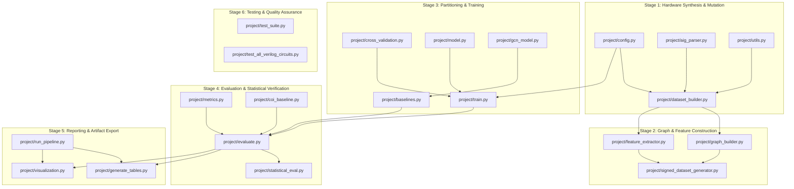

## Table of Contents

- [1. Executive System Overview](#1-executive-system-overview)
- [2. Component Dependency & Data Flow Map](#2-component-dependency--data-flow-map)
- [3. Core Model Architectures](#3-core-model-architectures)
  - [`project/model.py`](#projectmodelpy)
  - [`project/gcn_model.py`](#projectgcn_modelpy)
- [4. Circuit Parsing, Graph Construction & Feature Engineering](#4-circuit-parsing-graph-construction--feature-engineering)
  - [`project/aig_parser.py`](#projectaig_parserpy)
  - [`project/graph_builder.py`](#projectgraph_builderpy)
  - [`project/signed_dataset_generator.py`](#projectsigned_dataset_generatorpy)
  - [`project/feature_extractor.py`](#projectfeature_extractorpy)
- [5. Dataset Generation & Formal Verification Infrastructure](#5-dataset-generation--formal-verification-infrastructure)
  - [`project/dataset_builder.py`](#projectdataset_builderpy)
  - [`project/utils.py`](#projectutilspy)
- [6. Training Loop, Configuration & Loss Objectives](#6-training-loop-configuration--loss-objectives)
  - [`project/config.py`](#projectconfigpy)
  - [`project/train.py`](#projecttrainpy)
- [7. Evaluation, Decision Calibration & Baselines](#7-evaluation-decision-calibration--baselines)
  - [`project/evaluate.py`](#projectevaluatepy)
  - [`project/metrics.py`](#projectmetricspy)
  - [`project/coi_baseline.py`](#projectcoi_baselinepy)
  - [`project/baselines.py`](#projectbaselinespy)
- [8. Cross-Validation & Statistical Rigor Framework](#8-cross-validation--statistical-rigor-framework)
  - [`project/cross_validation.py`](#projectcross_validationpy)
  - [`project/statistical_eval.py`](#projectstatistical_evalpy)
- [9. Master Entrypoint, Sweeps & Ablation Runners](#9-master-entrypoint-sweeps--ablation-runners)
  - [`project/run_pipeline.py`](#projectrun_pipelinepy)
  - [`project/run_loss_experiments.py`](#projectrun_loss_experimentspy)
  - [`project/run_loss_grid_sweep.py`](#projectrun_loss_grid_sweeppy)
  - [`project/finish_loss_grid.py`](#projectfinish_loss_gridpy)
  - [`project/run_feature_ablation.py`](#projectrun_feature_ablationpy)
  - [`project/run_signed_ablation.py`](#projectrun_signed_ablationpy)
  - [`project/run_calibration_experiments.py`](#projectrun_calibration_experimentspy)
  - [`project/run_p0_ablation.py`](#projectrun_p0_ablationpy)
  - [`project/run_iscas85_c17_eval.py`](#projectrun_iscas85_c17_evalpy)
  - [`project/run_rebaseline.py`](#projectrun_rebaselinepy)
  - [`project/multi_fault_analysis.py`](#projectmulti_fault_analysispy)
- [10. Data & Checkpoint Migration Utilities](#10-data--checkpoint-migration-utilities)
  - [`project/migrate_features_11dim.py`](#projectmigrate_features_11dimpy)
  - [`project/migrate_features_12dim.py`](#projectmigrate_features_12dimpy)
  - [`project/checkpoint_migrate.py`](#projectcheckpoint_migratepy)
- [11. Visualization & Table Reporting](#11-visualization--table-reporting)
  - [`project/generate_tables.py`](#projectgenerate_tablespy)
  - [`project/visualization.py`](#projectvisualizationpy)
- [12. Unit Testing & Out-of-Distribution Hardware Tests](#12-unit-testing--out-of-distribution-hardware-tests)
  - [`project/test_suite.py`](#projecttest_suitepy)
  - [`project/test_all_verilog_circuits.py`](#projecttest_all_verilog_circuitspy)
- [13. Hardware Benchmark Directory (`verilog/`)](#13-hardware-benchmark-directory-verilog)
- [14. Documentation Suite (`docs/`)](#14-documentation-suite-docs)

---

## 1. Executive System Overview

The **GNN-Formal-Verification** system automates **Single-Point Fault Localization (SPFL)** in digital combinational netlists represented as And-Inverter Graphs (AIGs). 

When formal Combinational Equivalence Checking (CEC) fails between a golden hardware design and a faulty synthesized netlist, formal verification tools (such as Berkeley ABC) prove functional inequivalence and extract an input counterexample (CEX) vector. However, formal solvers only identify *that* a bug exists—they cannot identify *which internal logic gate* is physically buggy.

This framework solves that diagnosis bottleneck by converting the netlist and counterexample traces into a Directed Acyclic Graph (DAG) and using a **Bidirectional Graph Neural Network** (GraphSAGE or Relational SignedGraphSAGE) to produce an inductive suspiciousness ranking of internal logic gates. Downstream SAT/QBF rectification engines evaluate gates in this priority order, shrinking symbolic search time from combinatorial explosion to near-instantaneous verification.

---

## 2. Component Dependency & Data Flow Map

The following diagram illustrates how every major file in `project/` interacts within the end-to-end pipeline:

---

## 3. Core Model Architectures

### `project/model.py`
- **Location**: [`project/model.py`](file:///Users/het/Desktop/gnn_formal/project/model.py)
- **Core Purpose**: Houses the primary neural network architectures for node-level fault classification on netlists.
- **What It Does**:
  1. [`GraphSAGE`](file:///Users/het/Desktop/gnn_formal/project/model.py#L6-L125): A bidirectional 2-hop message-passing network. It runs two independent `SAGEConv` tracks on the same circuit graph:
     - **Forward track** (`flow='source_to_target'`): Models *controllability*—how signals propagate from Primary Inputs (PIs) downstream toward internal gates and outputs.
     - **Backward track** (`flow='target_to_source'`): Models *observability*—how sensitized discrepancies trace backward from failing Primary Outputs (POs) into the fan-in logic cone.
     - Uses [`torch.nn.LayerNorm`](file:///Users/het/Desktop/gnn_formal/project/model.py#L63-L66) instead of BatchNorm to handle variable circuit sizes (13 to 240+ nodes) without batch-dependency artifacts.
     - Implements multi-scale jumping-knowledge skip concatenation combining representations from all layers (`hf1, hf2, hb1, hb2`).
  2. [`SignedGraphSAGE`](file:///Users/het/Desktop/gnn_formal/project/model.py#L127-L237): A bidirectional Relational GNN (`RGCNConv`) designed for Signed AIG graphs where virtual inverters are contracted into signed edge relation types (`0`: direct wire, `1`: inverted wire).
     - Features residual skip connections (identity + LayerNorm + dropout).
     - Supports arbitrary depths $L \in \{2, 3, 4, 6, 8\}$ to test reachability across deep logic cones.
- **Inputs**: Node feature matrix $\mathbf{X} \in \mathbb{R}^{N \times D}$, edge index $\mathbf{E} \in \mathbb{Z}^{2 \times M}$, optional relation types $\mathbf{r} \in \{0, 1\}^M$.
- **Outputs**: Unbounded scalar logit per node $\hat{\mathbf{y}} \in \mathbb{R}^{N \times 1}$ representing fault suspiciousness.

---

### `project/gcn_model.py`
- **Location**: [`project/gcn_model.py`](file:///Users/het/Desktop/gnn_formal/project/gcn_model.py)
- **Core Purpose**: Provides an isotropic Graph Convolutional Network (GCN) baseline.
- **What It Does**:
  - Implements a standard 2-layer [`GCN`](file:///Users/het/Desktop/gnn_formal/project/gcn_model.py#L5-L38) using PyG `GCNConv`.
  - Normalizes edge flows isotropically without distinguishing forward controllability from backward observability.
  - Used in comparative experiments to isolate the exact empirical value of directional message-passing in digital logic.
- **Inputs**: $\mathbf{X} \in \mathbb{R}^{N \times D}$ and $\mathbf{E} \in \mathbb{Z}^{2 \times M}$.
- **Outputs**: Node classification logits $\hat{\mathbf{y}} \in \mathbb{R}^{N \times 1}$.

---

## 4. Circuit Parsing, Graph Construction & Feature Engineering

### `project/aig_parser.py`
- **Location**: [`project/aig_parser.py`](file:///Users/het/Desktop/gnn_formal/project/aig_parser.py)
- **Core Purpose**: Low-level parser and serializer for ASCII AIGER (`.aag`) files and formal verification counterexample outputs.
- **What It Does**:
  - Defines [`AigerCircuit`](file:///Users/het/Desktop/gnn_formal/project/aig_parser.py#L6-L113): Parses header specifications (`M, I, L, O, A`), primary inputs, latches, primary outputs, AND gate definitions ($lhs \leftarrow rhs_0 \land rhs_1$), symbol tables, and comments.
  - Implements [`write()`](file:///Users/het/Desktop/gnn_formal/project/aig_parser.py#L76-L113): Serializes mutated circuits back to standardized ASCII AIGER format for synthesis and verification tools.
  - Implements [`parse_cex_output()`](file:///Users/het/Desktop/gnn_formal/project/aig_parser.py#L115-L148): Extracts binary counterexample bit vectors ($X_{CEX} \in \{0, 1\}^{|V_{PI}|}$) from stdout produced by Berkeley ABC equivalence checking commands (`cec`, `&cec`, `dprove`).
- **Inputs**: File path to `.aag` file or raw console output string from ABC.
- **Outputs**: Populated `AigerCircuit` data structure or dictionary mapping input variables to binary assignments.

---

### `project/graph_builder.py`
- **Location**: [`project/graph_builder.py`](file:///Users/het/Desktop/gnn_formal/project/graph_builder.py)
- **Core Purpose**: Converts parsed AIGER circuit representations into NetworkX Directed Acyclic Graphs (`nx.DiGraph`).
- **What It Does**:
  - Implements [`build_circuit_graph()`](file:///Users/het/Desktop/gnn_formal/project/graph_builder.py#L5-L84).
  - Materializes explicit virtual NOT nodes (`"not_lit"`) whenever an input wire to an AND gate or primary output has an inverted literal ($literal \pmod 2 = 1$).
  - Assigns fundamental node attributes: `type` (`PI`, `PO`, `AND`, `NOT`, `LATCH`, `CONST0`), positive variable literal, and primary output indices (`po_index`).
- **Inputs**: [`AigerCircuit`](file:///Users/het/Desktop/gnn_formal/project/aig_parser.py#L6-L113) instance.
- **Outputs**: Directed NetworkX graph $G = (V, E)$ ready for topological analysis and feature extraction.

---

### `project/signed_dataset_generator.py`
- **Location**: [`project/signed_dataset_generator.py`](file:///Users/het/Desktop/gnn_formal/project/signed_dataset_generator.py)
- **Core Purpose**: Converts standard netlist graphs containing virtual NOT nodes into compact signed-edge relational graphs.
- **What It Does**:
  - Implements [`build_signed_circuit_graph()`](file:///Users/het/Desktop/gnn_formal/project/signed_dataset_generator.py#L15-L95): Eliminates virtual inverter nodes from the node set, directly connecting the driving gate to the fan-out gate with a relational edge label (`edge_type = 0` for direct wires, `edge_type = 1` for inverted wires).
  - Reduces total node count by 30–40%, effectively doubling 2-hop message-passing reach across inverted paths.
  - Implements batch dataset conversion functions that process all stored `.pt` files and save them to `project/data/variants_signed/`.
- **Inputs**: Standard PyG `Data` objects or NetworkX circuit graphs.
- **Outputs**: Compact relational PyG `Data` objects containing `edge_type` tensors.

---

### `project/feature_extractor.py`
- **Location**: [`project/feature_extractor.py`](file:///Users/het/Desktop/gnn_formal/project/feature_extractor.py)
- **Core Purpose**: Implements the **Oracle-Free Feature Extraction Engine** and logic simulation.
- **What It Does**:
  - Enforces the **Oracle-Free Contract**: Never queries or includes internal golden gate simulation values. Only uses information available on the buggy circuit, the CEX stimuli, and failing PO pins.
  - Computes the 12-dimensional node feature vector:
    1. `is_PI`: Primary Input indicator (binary).
    2. `is_PO`: Primary Output indicator (binary).
    3. `is_AND`: Two-input AND gate indicator (binary).
    4. `is_NOT`: Inverter node indicator (binary).
    5. `is_LATCH`: Sequential register indicator (binary).
    6. `is_CONST0`: Constant zero node indicator (binary).
    7. `fanin`: In-degree.
    8. `fanout`: Out-degree.
    9. `b_val`: Simulated Boolean logic value under counterexample inputs $X_{CEX}$.
    10. `norm_depth`: Topological depth from inputs divided by maximum circuit depth.
    11. `failing_po_prox`: BFS shortest-path proximity to failing primary outputs ($1 / (1 + \text{dist}_{BFS})$).
    12. `sim_toggle_rate`: Dynamic switching probability across random stimuli.
  - Implements [`simulate_circuit()`](file:///Users/het/Desktop/gnn_formal/project/feature_extractor.py#L87-L160) for bit-level CEX simulation in topological sort order.
  - Implements [`simulate_circuit_bitparallel()`](file:///Users/het/Desktop/gnn_formal/project/feature_extractor.py#L225-L390) for high-speed 64-vector bit-parallel toggle rate calculation.
  - Implements [`extract_node_features()`](file:///Users/het/Desktop/gnn_formal/project/feature_extractor.py#L393-L478) which packages features, binary labels, and node ordering maps.
- **Inputs**: NetworkX graph $G$, CEX input dictionary, list of failing POs, and injected faulty node index.
- **Outputs**: Node feature dictionary $\mathbf{X}$, binary label dictionary $\mathbf{y}$, and node ordering list.

---

## 5. Dataset Generation & Formal Verification Infrastructure

### `project/dataset_builder.py`
- **Location**: [`project/dataset_builder.py`](file:///Users/het/Desktop/gnn_formal/project/dataset_builder.py)
- **Core Purpose**: Generates synthetic benchmark circuits, performs hardware mutation, and filters variants through formal equivalence checking.
- **What It Does**:
  - Houses behavioral Verilog definitions for 7 benchmark circuits in [`BENCHMARKS`](file:///Users/het/Desktop/gnn_formal/project/dataset_builder.py#L16-L86): `full_adder`, `ripple_carry_adder`, `mux21`, `comparator4`, `parity_checker`, `priority_encoder`, and `alu4`.
  - Implements [`write_verilog_files()`](file:///Users/het/Desktop/gnn_formal/project/dataset_builder.py#L88-L96) and [`synthesize_to_aiger()`](file:///Users/het/Desktop/gnn_formal/project/dataset_builder.py#L97-L114): Invokes **Yosys** (`synth -flatten; aigmap`) to compile Verilog into golden ASCII AIGER files.
  - Implements [`inject_fault()`](file:///Users/het/Desktop/gnn_formal/project/dataset_builder.py#L115-L196) covering 6 physical fault models:
    - `SA0`: Stuck-At-0 on internal gate output.
    - `SA1`: Stuck-At-1 on internal gate output.
    - `INV_IN0`: Invert fan-in pin 0.
    - `INV_IN1`: Invert fan-in pin 1.
    - `INV_OUT`: Invert gate output (AND becomes NAND).
    - `CONN_FAULT`: Rewire fan-in pin 0 to an arbitrary valid upstream literal.
  - Formal Verification Filter: Executes Berkeley ABC Combinational Equivalence Checking (`cec golden.aig buggy.aig`). Discards functionally equivalent mutations or timeouts; extracts concrete CEX vectors for true bugs.
  - Serializes verified instances to PyG `Data` objects saved under `project/data/variants/`.
- **Inputs**: Hardware specifications, fault count target (`MAX_FAULTS=1` for SPFL), tool paths for Yosys and ABC.
- **Outputs**: 700 verified PyG circuit graphs saved as individual `.pt` files.

---

### `project/utils.py`
- **Location**: [`project/utils.py`](file:///Users/het/Desktop/gnn_formal/project/utils.py)
- **Core Purpose**: Core operational utilities, logging, subprocess execution, and lazy dataset loading.
- **What It Does**:
  - Implements [`LazyCircuitDataset`](file:///Users/het/Desktop/gnn_formal/project/utils.py#L45-L135): A PyG-compatible dataset container that loads graphs on-demand from disk and retains an in-memory cache to prevent disk I/O bottlenecks during training.
  - Implements [`run_cmd()`](file:///Users/het/Desktop/gnn_formal/project/utils.py#L22-L43): Safe subprocess execution wrapper with timeout handling and stderr capture for external EDA tools (Yosys, ABC).
  - Configures unified project logging (`logger`).
- **Inputs**: File system paths, external command strings.
- **Outputs**: Process return codes, stdout/stderr streams, cached PyG `Data` objects.

---

## 6. Training Loop, Configuration & Loss Objectives

### `project/config.py`
- **Location**: [`project/config.py`](file:///Users/het/Desktop/gnn_formal/project/config.py)
- **Core Purpose**: Single source of truth for all global hyperparameters, dataset quotas, and model settings.
- **What It Does**:
  - Declares model configurations: `IN_CHANNELS=12`, `HIDDEN_CHANNELS=64`, `OUT_CHANNELS=1`, `NUM_LAYERS=2`, `DROPOUT=0.3`.
  - Declares loss configurations: `LOSS_TYPE="ranking"`, `RANKING_WEIGHT=0.5`, `RANKING_MARGIN=1.0`.
  - Declares dataset quotas: `SPFL_MODE=True`, `NUM_VARIANTS_NEEDED=700`, `VARIANTS_PER_CIRCUIT_TARGET=100`, `MAX_FAULTS=1`.
  - Declares training settings: `NUM_EPOCHS=200`, `BATCH_SIZE=16`, `LEARNING_RATE=0.001`, `WEIGHT_DECAY=1e-4`, `EARLY_STOP_PATIENCE=25`.
  - Declares evaluation settings: `KFOLD_K=5`, `NUM_SEEDS=10`, `COI_MASKING=True`.

---

### `project/train.py`
- **Location**: [`project/train.py`](file:///Users/het/Desktop/gnn_formal/project/train.py)
- **Core Purpose**: Implements the training loop, optimizer scheduling, and compound loss functions.
- **What It Does**:
  - Defines [`CircuitFaultLoss`](file:///Users/het/Desktop/gnn_formal/project/train.py#L36-L235):
    - **Global Weighted BCE**: Scales positive class loss by $w_{pos} \approx 76.4$ (derived once globally from the dataset imbalance).
    - **Vectorized Pairwise Margin Ranking Loss**: Enforces that within each graph $g$, the positive faulty gate outranks all healthy gates by margin $\gamma=1.0$. Vectorized in $O(N)$ time using PyG `scatter` operations to eliminate nested Python loops.
    - Supports optional Focal Loss and Listwise Softmax Cross-Entropy.
  - Implements [`run_training()`](file:///Users/het/Desktop/gnn_formal/project/train.py#L353-L490):
    - Constructs mini-batches using `torch_geometric.loader.DataLoader`.
    - Optimizes with Adam and `CosineAnnealingLR` scheduler.
    - Tracks validation Top-3 accuracy on the validation circuit (`parity_checker`).
    - Implements early stopping with patience of 25 epochs.
    - Saves the optimal model state dictionary to `best_model.pt`.
- **Inputs**: Dataset directory, training epochs, learning rate, weight decay.
- **Outputs**: Saved checkpoint `best_model.pt`, loss history arrays, and learning curve plot.

---

## 7. Evaluation, Decision Calibration & Baselines

### `project/evaluate.py`
- **Location**: [`project/evaluate.py`](file:///Users/het/Desktop/gnn_formal/project/evaluate.py)
- **Core Purpose**: Executes post-training evaluation, diagnostic ranking, and threshold calibration.
- **What It Does**:
  - Implements [`calibrate_threshold()`](file:///Users/het/Desktop/gnn_formal/project/evaluate.py#L14-L33): Computes Precision-Recall curves on validation graphs to identify the $F_1$-optimal decision boundary ($\tau^* \approx 0.85\text{--}0.94$), counteracting the 76:1 class imbalance.
  - Implements [`evaluate_on_test()`](file:///Users/het/Desktop/gnn_formal/project/evaluate.py#L51-L245):
    - Computes suspiciousness scores for all nodes.
    - Applies inference-time **COI Masking**: Nodes outside the backward cone-of-influence of failing POs are set to $-\infty$ logits.
    - Calculates Top-1, Top-3, Top-5, and Top-10 diagnostic hit rates.
    - Computes Mean Bug Rank across held-out circuits.
    - Computes uncalibrated vs calibrated Precision, Recall, $F_1$, ROC-AUC, and PR-AUC.
- **Inputs**: Model checkpoint path, test dataset split, calibrated decision threshold.
- **Outputs**: Comprehensive evaluation metrics dictionary.

---

### `project/metrics.py`
- **Location**: [`project/metrics.py`](file:///Users/het/Desktop/gnn_formal/project/metrics.py)
- **Core Purpose**: Centralized calculation functions for hardware fault localization metrics.
- **What It Does**:
  - Implements [`get_buggy_indices()`](file:///Users/het/Desktop/gnn_formal/project/metrics.py#L18-L24): Extracts ground-truth mutated node IDs from graph objects.
  - Implements [`topk_check()`](file:///Users/het/Desktop/gnn_formal/project/metrics.py#L30-L42): Determines whether ground-truth buggy gates appear in the top-K positions of ranked predictions.
  - Implements [`compute_coi()`](file:///Users/het/Desktop/gnn_formal/project/metrics.py#L48-L76) and [`compute_coi_from_edge_index()`](file:///Users/het/Desktop/gnn_formal/project/metrics.py#L79-L110): Backward BFS traversal computing the Cone-of-Influence starting from failing PO pins.
  - Implements [`compute_classification_metrics()`](file:///Users/het/Desktop/gnn_formal/project/metrics.py#L113-L170): Evaluates standard binary classification statistics (Precision, Recall, F1, ROC-AUC, PR-AUC).
- **Inputs**: Ground-truth labels, prediction arrays, graph connectivity structures.
- **Outputs**: Standardized diagnostic and classification scores.

---

### `project/coi_baseline.py`
- **Location**: [`project/coi_baseline.py`](file:///Users/het/Desktop/gnn_formal/project/coi_baseline.py)
- **Core Purpose**: Implements the classic EDA Cone-of-Influence (COI) topological heuristic baseline.
- **What It Does**:
  - Traverses the circuit netlist backward via BFS from failing primary outputs.
  - Assigns suspiciousness scores to nodes strictly proportional to their proximity to failing outputs ($1 / (1 + \text{dist}_{BFS})$) or uniform probability across the COI.
  - Serves as the primary non-learning engineering baseline: proves that simple structural reachability is insufficient for gate-level pinpointing (achieving 0.0% Top-1 vs GNN's 50.9%).
- **Inputs**: Test circuit graphs with identified failing POs.
- **Outputs**: Baseline diagnostic metrics dictionary.

---

### `project/baselines.py`
- **Location**: [`project/baselines.py`](file:///Users/het/Desktop/gnn_formal/project/baselines.py)
- **Core Purpose**: Suite of alternative fault localization baselines for rigorous benchmarking.
- **What It Does**:
  - Implements [`run_ochiai_baseline()`](file:///Users/het/Desktop/gnn_formal/project/baselines.py#L90-L143): Adapts software Spectrum-Based Fault Localization (SBFL) Ochiai formula ($1 / \sqrt{|COI|}$) to netlists.
  - Implements [`run_tarantula_baseline()`](file:///Users/het/Desktop/gnn_formal/project/baselines.py#L148-L200): Adapts the Tarantula SBFL formula to netlists.
  - Implements [`run_xgboost_baseline()`](file:///Users/het/Desktop/gnn_formal/project/baselines.py#L205-L277): Trains a flat gradient-boosted decision tree on tabular node features (ignoring graph structure) with class weighting.
  - Implements [`run_gcn_baseline()`](file:///Users/het/Desktop/gnn_formal/project/baselines.py#L282-L382): Trains an isotropic Graph Convolutional Network.
- **Inputs**: Train, validation, and test dataset splits.
- **Outputs**: Baseline performance metrics tables for comparative analysis.

---

## 8. Cross-Validation & Statistical Rigor Framework

### `project/cross_validation.py`
- **Location**: [`project/cross_validation.py`](file:///Users/het/Desktop/gnn_formal/project/cross_validation.py)
- **Core Purpose**: Circuit-level 5-fold cross-validation engine enforcing zero data leakage.
- **What It Does**:
  - Implements [`circuit_kfold_split()`](file:///Users/het/Desktop/gnn_formal/project/cross_validation.py#L20-L80): Partitions datasets by *whole circuits* rather than individual variants.
  - Implements [`_assert_no_leakage()`](file:///Users/het/Desktop/gnn_formal/project/cross_validation.py#L82-L95): Programmatic assertion ensuring $(V_{train} \cap V_{val} \cap V_{test}) = \emptyset$.
  - Implements [`run_circuit_cross_validation()`](file:///Users/het/Desktop/gnn_formal/project/cross_validation.py#L98-L269):
    - Iterates across 5 folds, training on 4 circuits, validating on 1, and testing on 2.
    - Saves per-fold models and evaluates out-of-sample Top-1, Top-3, Top-5, Top-10, and calibrated precision.
    - Exports fold-by-fold results to `project/data/cv_results.csv`.
- **Inputs**: Dataset file paths, fold count $K=5$, training hyperparameters.
- **Outputs**: Summary DataFrame with mean $\pm$ standard deviation across rotating test splits.

---

### `project/statistical_eval.py`
- **Location**: [`project/statistical_eval.py`](file:///Users/het/Desktop/gnn_formal/project/statistical_eval.py)
- **Core Purpose**: Multi-seed statistical significance testing.
- **What It Does**:
  - Implements [`run_multi_seed_evaluation()`](file:///Users/het/Desktop/gnn_formal/project/statistical_eval.py#L80-L252): Evaluates the pipeline across 10 random seeds (`SEEDS = 0..9`).
  - Implements [`compute_statistics()`](file:///Users/het/Desktop/gnn_formal/project/statistical_eval.py#L14-L78): Performs two-sided paired **Wilcoxon signed-rank tests** comparing GraphSAGE against COI and GCN baselines.
  - Annotates statistical significance thresholds ($p < 0.05^*$, $p < 0.01^{**}$, $p < 0.001^{***}$) and logs effect sizes to eliminate cherry-picking.
  - Exports statistical distributions to `project/data/multi_seed_results.csv`.
- **Inputs**: Data directory, seed count, baseline comparison targets.
- **Outputs**: Statistical significance reports and p-value tables.

---

## 9. Master Entrypoint, Sweeps & Ablation Runners

### `project/run_pipeline.py`
- **Location**: [`project/run_pipeline.py`](file:///Users/het/Desktop/gnn_formal/project/run_pipeline.py)
- **Core Purpose**: Master orchestrator executing the end-to-end research pipeline.
- **What It Does**:
  1. Writes benchmark Verilog files to `project/data/circuits/`.
  2. Synthesizes golden AIGER netlists and generates 700 mutant variants.
  3. Trains the production GraphSAGE model.
  4. Calibrates decision thresholds on validation PR curves.
  5. Evaluates out-of-sample test performance.
  6. Evaluates the COI heuristic baseline.
  7. Generates Tables 1, 2, 3, and 4 (CSV, Excel, LaTeX).
  8. Generates all 10 publication figures.
  9. Runs circuit-level 5-fold cross-validation.
  10. Runs 10-seed statistical evaluation.
  11. Writes `summary_report.txt`.
- **Usage**: `python project/run_pipeline.py`

---

### `project/run_loss_experiments.py`
- **Location**: [`project/run_loss_experiments.py`](file:///Users/het/Desktop/gnn_formal/project/run_loss_experiments.py)
- **Core Purpose**: Controlled ablation study comparing loss formulations.
- **What It Does**:
  - Evaluates three loss modes across 5-fold CV: Weighted BCE, Focal Loss ($\gamma=2.0, \alpha=0.25$), and Compound BCE + Pairwise Ranking ($\lambda=0.5, \gamma=1.0$).
  - Exports comparative findings to `project/data/loss_comparison_cv.csv`.

---

### `project/run_loss_grid_sweep.py` & `project/finish_loss_grid.py`
- **Location**: [`project/run_loss_grid_sweep.py`](file:///Users/het/Desktop/gnn_formal/project/run_loss_grid_sweep.py) & [`project/finish_loss_grid.py`](file:///Users/het/Desktop/gnn_formal/project/finish_loss_grid.py)
- **Core Purpose**: Hyperparameter grid search over loss weights and ranking margins.
- **What It Does**:
  - Sweeps ranking weight $\lambda_{rank} \in \{0.25, 0.5, 1.0\}$ and margin $\gamma \in \{0.5, 1.0, 2.0\}$ across all 5 folds.
  - `finish_loss_grid.py` provides resilient resume capabilities if sweeps are interrupted.
  - Saves full grid results to `project/data/loss_grid_sweep_cv.csv`.

---

### `project/run_feature_ablation.py`
- **Location**: [`project/run_feature_ablation.py`](file:///Users/het/Desktop/gnn_formal/project/run_feature_ablation.py)
- **Core Purpose**: Measures individual contributions of feature components.
- **What It Does**:
  - Compares 10-dim baseline (structural + b_val + depth) vs 11-dim (+ failing-PO proximity) vs 12-dim (+ dynamic switching toggle rate).
  - Runs 5-fold CV to quantify the exact gain of observability-conditioning features.
  - Exports ablation results to `project/data/feature_ablation_cv.csv`.

---

### `project/run_signed_ablation.py`
- **Location**: [`project/run_signed_ablation.py`](file:///Users/het/Desktop/gnn_formal/project/run_signed_ablation.py)
- **Core Purpose**: Graph representation ablation: Virtual NOTs vs Relational Signed Edges.
- **What It Does**:
  - Trains `SignedGraphSAGE` with residual connections on signed datasets in `project/data/variants_signed/`.
  - Compares diagnostic reach against standard `GraphSAGE` on virtual-NOT graphs.
  - Exports comparative CV results to `project/data/signed_ablation_cv.csv`.

---

### `project/run_calibration_experiments.py`
- **Location**: [`project/run_calibration_experiments.py`](file:///Users/het/Desktop/gnn_formal/project/run_calibration_experiments.py)
- **Core Purpose**: Ablation on post-training decision threshold strategies.
- **What It Does**:
  - Compares default uncalibrated threshold ($\tau=0.50$), validation $F_1$-optimal threshold ($\tau^* \approx 0.94$), and Isotonic Regression calibration across 5-fold CV.
  - Saves metrics to `project/data/calibration_comparison_cv.csv`.

---

### `project/run_p0_ablation.py`
- **Location**: [`project/run_p0_ablation.py`](file:///Users/het/Desktop/gnn_formal/project/run_p0_ablation.py)
- **Core Purpose**: Ablation study for Priority-0 architectural fixes.
- **What It Does**:
  - Isolates the performance delta provided by bidirectional message-passing, LayerNorm, and jumping-knowledge concat.

---

### `project/run_iscas85_c17_eval.py`
- **Location**: [`project/run_iscas85_c17_eval.py`](file:///Users/het/Desktop/gnn_formal/project/run_iscas85_c17_eval.py)
- **Core Purpose**: Zero-shot transfer evaluation on external ISCAS-85 benchmark circuits.
- **What It Does**:
  - Takes models trained strictly on synthetic benchmarks and evaluates fault localization accuracy on the ISCAS-85 `c17` benchmark circuit without fine-tuning.

---

### `project/run_rebaseline.py`
- **Location**: [`project/run_rebaseline.py`](file:///Users/het/Desktop/gnn_formal/project/run_rebaseline.py)
- **Core Purpose**: Complete re-baselining script validating production stability.
- **What It Does**:
  - Re-executes 5-fold CV across 12-dimensional features and ranking loss, verifying that performance matches or exceeds target baseline metrics.
  - Writes execution logs to `project/data/rebaseline_log.txt` and metrics to `project/data/rebaseline_cv.csv`.

---

### `project/multi_fault_analysis.py`
- **Location**: [`project/multi_fault_analysis.py`](file:///Users/het/Desktop/gnn_formal/project/multi_fault_analysis.py)
- **Core Purpose**: Evaluates localization when multiple concurrent faults are present ($K > 1$).
- **What It Does**:
  - Evaluates Top-K hit rates when variants contain 2, 3, or more concurrent mutations.
  - Under SPFL mode (`config.SPFL_MODE=True`), this module is automatically bypassed.

---

## 10. Data & Checkpoint Migration Utilities

### `project/migrate_features_11dim.py`
- **Location**: [`project/migrate_features_11dim.py`](file:///Users/het/Desktop/gnn_formal/project/migrate_features_11dim.py)
- **Core Purpose**: In-place feature migration from 10 dimensions to 11 dimensions.
- **What It Does**:
  - Inspects existing cached `.pt` files in `project/data/variants/`.
  - Computes BFS failing-PO distance and appends feature index 10 (`failing_po_prox`) without requiring complete re-synthesis from Verilog.

---

### `project/migrate_features_12dim.py`
- **Location**: [`project/migrate_features_12dim.py`](file:///Users/het/Desktop/gnn_formal/project/migrate_features_12dim.py)
- **Core Purpose**: In-place feature migration from 11 dimensions to 12 dimensions.
- **What It Does**:
  - Appends bit-parallel dynamic switching toggle rates as feature index 11 (`sim_toggle_rate`) across all 700 cached variant graphs.

---

### `project/checkpoint_migrate.py`
- **Location**: [`project/checkpoint_migrate.py`](file:///Users/het/Desktop/gnn_formal/project/checkpoint_migrate.py)
- **Core Purpose**: Migrates legacy model checkpoints to newer parameter structures.
- **What It Does**:
  - Remaps parameter names and expands linear layer weights when moving from unidirectional GraphSAGE or fewer feature channels to modern bidirectional models.

---

## 11. Visualization & Table Reporting

### `project/generate_tables.py`
- **Location**: [`project/generate_tables.py`](file:///Users/het/Desktop/gnn_formal/project/generate_tables.py)
- **Core Purpose**: Formats, computes, and exports publication-ready evaluation tables.
- **What It Does**:
  - Exports Table 1: Circuit benchmark characteristics (`table1_circuits.csv`).
  - Exports Table 2: Node feature definitions and ranges (`table2_features.csv`).
  - Exports Table 3: Overall test performance comparison GNN vs Baselines (`table3_results.csv`).
  - Exports Table 4: Strictly test-only per-circuit performance breakdown (`table4_per_circuit_test.csv`).
  - Generates multi-sheet Excel workbook (`evaluation_tables.xlsx`) and LaTeX booktabs source code (`tables.tex`).

---

### `project/visualization.py`
- **Location**: [`project/visualization.py`](file:///Users/het/Desktop/gnn_formal/project/visualization.py)
- **Core Purpose**: High-resolution Matplotlib figure generation suite.
- **What It Does**:
  - Plot 1: Circuit Graph Topological Visualization (`plot1_circuit_graph.png`).
  - Plot 2: Buggy Gate k-hop Neighborhood Subgraph (`plot2_buggy_neighborhood.png`).
  - Plot 3: Feature Distribution & Correlation Heatmaps (`plot3_features.png`).
  - Plot 4: Node Degree Distributions (`plot4_degrees.png`).
  - Plot 5: Topological Depth Distributions (`plot5_depths.png`).
  - Plot 6: Receiver Operating Characteristic Curves (`plot6_roc_curve.png`).
  - Plot 7: Precision-Recall Curves with calibrated thresholds (`plot7_pr_curve.png`).
  - Plot 8: Top-K Localization Accuracy Bar Chart (`plot8_localization_accuracy.png`).
  - Plot 9: Cone-of-Influence Size Distribution (`plot9_coi_size_distribution.png`).
  - Plot 10: Multi-Fault Count Distribution (`plot10_fault_count_dist.png`).
  - Learning Curves: Training loss vs validation Top-3 accuracy over epochs (`learning_curves.png`).

---

## 12. Unit Testing & Out-of-Distribution Hardware Tests

### `project/test_suite.py`
- **Location**: [`project/test_suite.py`](file:///Users/het/Desktop/gnn_formal/project/test_suite.py)
- **Core Purpose**: Comprehensive unit test suite maintaining codebase integrity.
- **What It Does**:
  - Contains **102 automated unit tests** covering:
    - AIGER ASCII parsing and serialization integrity.
    - Graph DAG validation and cycle-detection assertions.
    - Oracle-free feature bounds and dimension assertions.
    - Forward and backward message-passing output shapes.
    - Vectorized ranking loss numerical equivalence against loop implementations.
    - Bit-parallel logic simulation bit-for-bit equivalence against serial execution.
    - Programmatic zero-data-leakage verification between train/val/test splits.
  - Run via: `python -m unittest project/test_suite.py`

---

### `project/test_all_verilog_circuits.py`
- **Location**: [`project/test_all_verilog_circuits.py`](file:///Users/het/Desktop/gnn_formal/project/test_all_verilog_circuits.py)
- **Core Purpose**: End-to-end out-of-distribution evaluation on hand-written Verilog designs.
- **What It Does**:
  - Tests the trained neural model on 7 genuine, hand-crafted Verilog benchmarks in `verilog/` representing real-world human RTL bugs (e.g., typos in assign statements, inverted control lines, reversed priority orders).
  - Generates comprehensive diagnostic verification reports in `project/data/verilog_evaluation_report.txt`.

---

## 13. Hardware Benchmark Directory (`verilog/`)

The `verilog/` folder contains standalone, hand-crafted hardware designs featuring golden references, buggy implementations, Verilog testbenches, and Yosys synthesis scripts:

| Benchmark Directory | Circuit Function | Injected Real-World Defect Description |
| :--- | :--- | :--- |
| `verilog/full_adder/` | 1-bit Full Adder | Missing carry-out logic term in boolean sum-of-products. |
| `verilog/4_bit_adder/` | 4-bit Ripple Carry Adder | Bit 2 internal XOR replaced with AND gate. |
| `verilog/ALU/` | 4-bit Arithmetic Logic Unit | Arithmetic ADD and SUB operation opcodes swapped. |
| `verilog/comparator/` | 4-bit Magnitude Comparator | Relational operator mutated ($>$ replaced with $\ge$). |
| `verilog/multiplexer/2x1/` | 2-to-1 Multiplexer | Select control line inverted. |
| `verilog/multiplexer/4x1/` | 4-to-1 Multiplexer | Select bit indexing reversed (`sel[0]` vs `sel[1]`). |
| `verilog/parity_checker/` | 8-bit Even Parity Checker | Reduction XNOR replaced with reduction XOR. |
| `verilog/priority_encoder/`| 8-to-3 Priority Encoder | Priority order reversed (LSB priority instead of MSB). |

---

## 14. Documentation Suite (`docs/`)

| Document | Purpose & Contents |
| :--- | :--- |
| [`docs/GNN_MODEL.md`](file:///Users/het/Desktop/gnn_formal/docs/GNN_MODEL.md) | Exhaustive mathematical specification of the GNN architecture, message passing equations, loss formulations, inference procedures, and hyperparameter tables. |
| [`docs/memory.md`](file:///Users/het/Desktop/gnn_formal/docs/memory.md) | Running project context log, chronological record of audits, architectural modifications, decisions, and measured results. |
| [`docs/prd.md`](file:///Users/het/Desktop/gnn_formal/docs/prd.md) | Product Requirements Document (PRD v2.0) defining system requirements, evaluation standards, and defensible baselines. |
| [`docs/IMPROVEMENT_REPORT.md`](file:///Users/het/Desktop/gnn_formal/docs/IMPROVEMENT_REPORT.md) | Formal engineering report documenting empirical gains, baseline reconciliations, and ablation studies. |
| [`docs/FILE_GUIDE.md`](file:///Users/het/Desktop/gnn_formal/docs/FILE_GUIDE.md) | This file: complete architecture, module interactions, and file-by-file explanations. |
